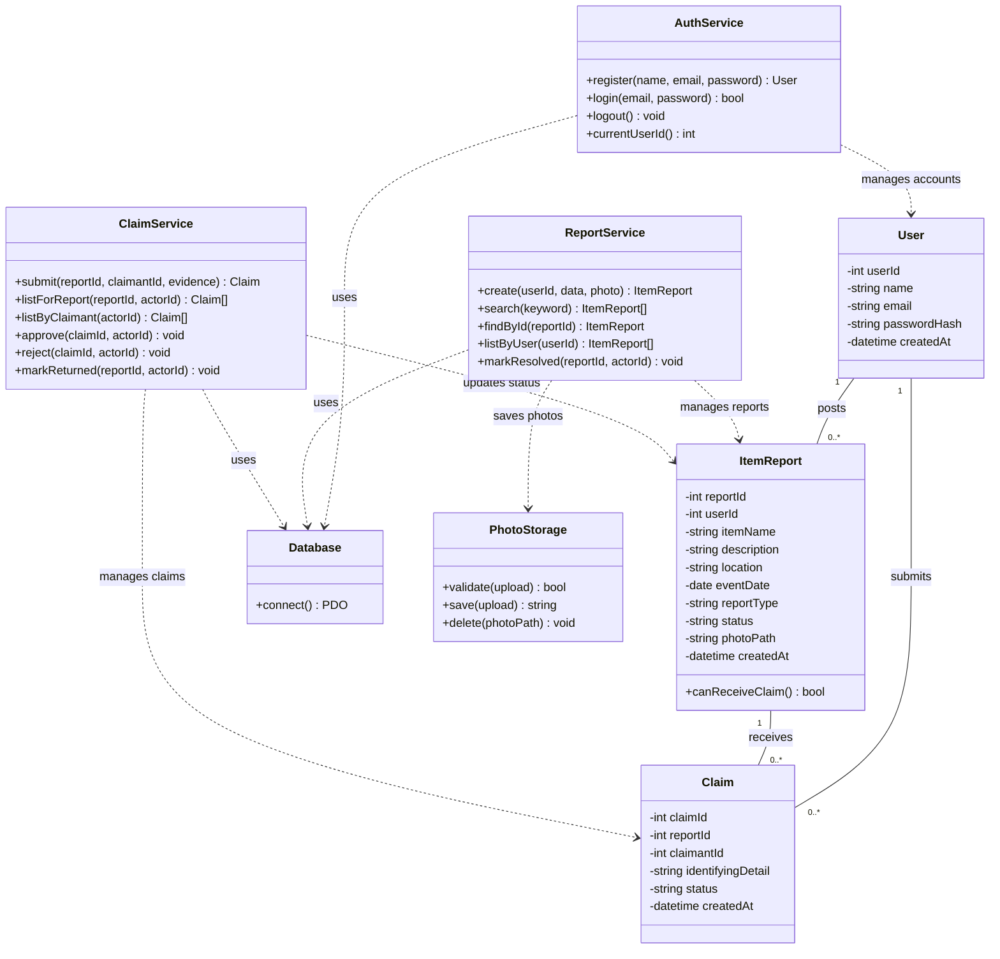

# System design — Campus Lost-and-Found System

Status: Approved design draft. Implementation and testing are pending.

## Architecture
The presentation layer contains HTML/CSS pages and PHP request handlers. The application layer handles validation, sessions, permissions, and report/claim rules through the services below. Database access uses a shared PDO connection and prepared queries. Services coordinate queries and transactions for this small project.

## UML class diagram
Private attributes use minus signs. Public methods use plus signs. Finder and claimant are roles of User.

photoPath is optional. The implementation must handle a signed-out currentUserId and a missing findById result, using nullable results or explicit errors as appropriate. Actor IDs must come from the authenticated server session. The services check ownership before protected operations.

ClaimService owns approval because it changes both a claim and its report. PhotoStorage validates and saves image files. Database supplies the shared PHP-to-MySQL connection.

## MySQL fields
All fields are required except photo_path. Primary keys auto-increment. created_at defaults to CURRENT_TIMESTAMP.

### users
| Field | Type | Constraint |
|---|---|---|
| user_id | INT UNSIGNED | Primary key, auto-increment |
| name | VARCHAR(100) | Required |
| email | VARCHAR(255) | Required, unique |
| password_hash | VARCHAR(255) | Required |
| created_at | DATETIME | Default CURRENT_TIMESTAMP |

### item_reports
| Field | Type | Constraint |
|---|---|---|
| report_id | INT UNSIGNED | Primary key, auto-increment |
| user_id | INT UNSIGNED | Foreign key to users.user_id |
| item_name | VARCHAR(150) | Required |
| description | TEXT | Required |
| location | VARCHAR(200) | Required |
| event_date | DATE | Required |
| report_type | ENUM('lost','found') | Required |
| status | ENUM('open','reserved','returned','resolved') | Default 'open' |
| photo_path | VARCHAR(255) | Nullable |
| created_at | DATETIME | Default CURRENT_TIMESTAMP |

### claims
| Field | Type | Constraint |
|---|---|---|
| claim_id | INT UNSIGNED | Primary key, auto-increment |
| report_id | INT UNSIGNED | Foreign key to item_reports.report_id |
| claimant_id | INT UNSIGNED | Foreign key to users.user_id |
| identifying_detail | TEXT | Required, accessible only to claimant and finder |
| status | ENUM('pending','approved','rejected','closed') | Default 'pending' |
| created_at | DATETIME | Default CURRENT_TIMESTAMP |

## Relationships and rules
One user posts zero or more reports and submits zero or more claims. Each report has exactly one author. Each claim has exactly one claimant and one report. A report receives zero or more claims. The finder is obtained through item_reports.user_id.

Use foreign keys and restrict deletion of referenced records. Application rules additionally require:
- Claims apply only to open found reports posted by another user.
- Only the finder can approve/reject a pending claim.
- At most one claim per report is approved.
- Approval changes the report from open to reserved and closes other pending claims.
- Only the finder can mark a reserved report returned after handover.
- Only a lost report's author can mark it resolved.
- Approval is final in the initial scope. Reopening reservations and disputes remain future improvements.

Approval must lock the report row, recheck status, and update all affected records in one transaction. Claim submission must coordinate with approval through the same report lock so it cannot insert a pending claim after approval.

## Photos and local storage
One optional JPG or PNG, maximum 5 MB, is allowed on each lost/found report. PHP validates the actual image type and size and assigns a unique filename. The list shows a thumbnail, details show the larger image, and missing photos show a placeholder.

Store images outside htdocs, for example C:/xampp/campus-lost-found-storage/items. Store only a relative value such as items/a81f2c.jpg in photo_path. A PHP image endpoint serves validated image content without exposing storage as executable website content. Invalid submissions must create no report. On a database failure, clean up newly saved files.

Photos are public. Keep at least one ownership-identifying detail out of photos and public descriptions. Each teammate uses their own local database and storage folder. Exclude private configuration and personal uploads from Git and document the settings in a configuration example.

## Screens
| Screen | Actions |
|---|---|
| Browse Items | Browse, search, see thumbnails, open details |
| Register / Login | Register, sign in, sign out |
| Report an Item | Enter required report fields and optionally select a photo with preview |
| Item Details | View details and image, submit evidence when eligible |
| My Reports | Review own reports and claims, approve/reject, record return or recovery |
| My Claims | View own evidence and current claim status |

## Delivery order
1. Shared XAMPP foundation, schema, connection, configuration example, and setup instructions.
2. Accounts.
3. Reports with photos and search.
4. Claims and returns.
5. Complete workflow testing and documentation review.

These are design decisions and planned checks. No application behavior has yet been verified.
